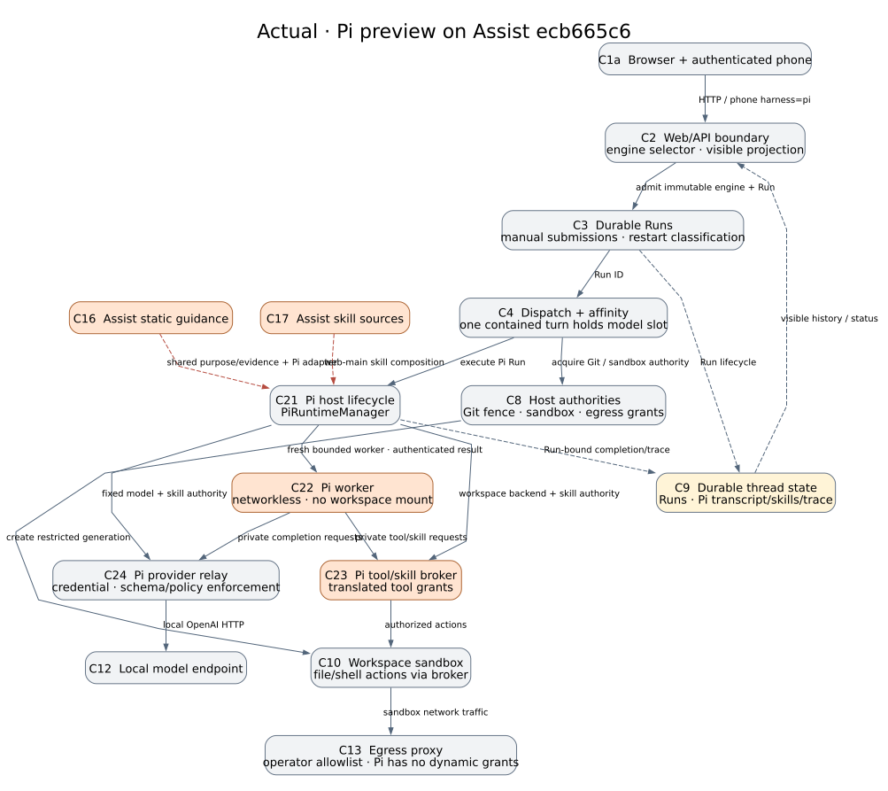
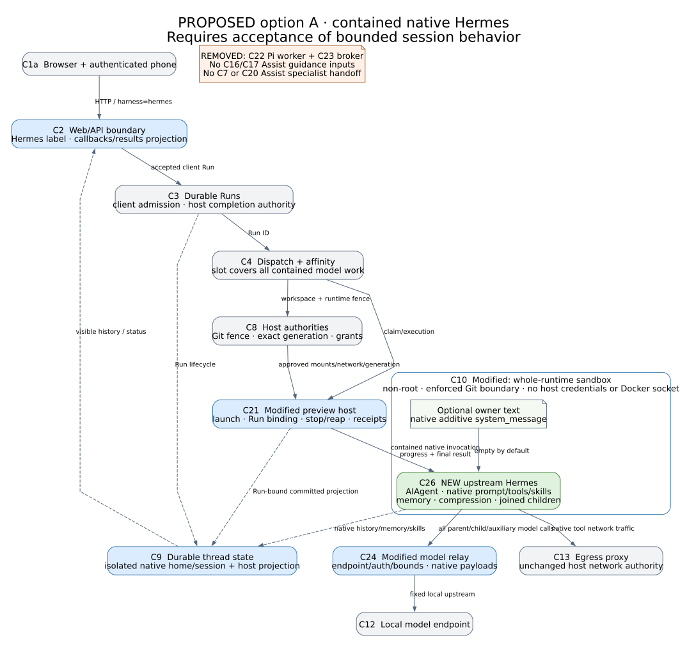

#+title: Replacing the Pi preview with Hermes Agent
#+date: 2026-11-10
#+options: toc:2 num:nil

* Problem

The alternative engine should let a user work with Hermes Agent through
Assist's existing conversation UI. Hermes should supply its own agent loop,
prompt, skills, memory and delegation. Replacing Pi's model loop while keeping
Assist's specialist instructions would defeat that purpose. An optional short
owner instruction may supplement Hermes; it should not rebuild Assist inside it.

This is a design proposal, not an implemented replacement. Deep Agents remains
the default. No service, prompt, model, client or runtime configuration changes
in this effort. The source examined is Assist =ecb665c629429803a892f0245b600e266ef5a430=.
Upstream Hermes is pinned for this review to
=ec3249919accf7bc51f780dcff663e8f19a0e176=, observed on 2026-11-10. Pinning is
necessary because its native interfaces are changing quickly.

There is one material product choice. A bounded alternative to today's Pi
preview can use Hermes's native Python agent in a contained turn. A full Hermes
session with detached work and later self-wakes is better served by its native
gateway. Those are different lifetime contracts. This document makes that
choice explicit before runtime work starts.

* Evidence

** What Pi actually owns today

The [[file:architecture.org][merged architecture]] describes the ordinary Deep Agents path using stable
component IDs C1a–C20d. The following actual view expands its Pi branch; C21–C24
name previously unmapped Pi components. They keep these meanings in the proposed
view. Orange components are removed by the proposed bounded replacement.

The browser selects an immutable =pi= engine marker when reserving a new thread.
Missing markers select legacy Deep Agents; malformed markers fail closed.
[[file:../assist/thread_engine.py][Thread engine identity]] prevents a later request from changing the engine.
The operator can disable the preview. [[file:../manage/web/threads.py][=_execute_pi_run=]] takes C4's model affinity
slot and C8's Git workspace fence, rechecks that switch, claims the durable C3
Run, and starts a fresh Pi worker. It does not construct
a Deep Agents graph. Interrupted execution is not replayed automatically; a
previously committed reply can reconcile the Run without rerunning tools.

Although engine origins and the runtime call this =manual-web=, the
[[file:../manage/web/phone_api.py][authenticated phone API]] also advertises Pi in its harness catalog and accepts
manual Pi submissions. It deliberately does not reserve the normal live token
stream for them. Replacing only the browser selector would leave a stale phone
contract. CLI, direct =AgentSpec= embedders, voice, schedules and Assist child
Runs are different entry paths; this design does not switch those to Hermes.

[[file:../assist/pi_runtime.py][C21 PiRuntimeManager]] starts C22, a networkless, read-only worker container
without a workspace mount. C23, the [[file:../assist/pi_broker.py][Pi tool broker]], alone holds the separate
C10 workspace sandbox. It mediates coding tools, skill loading and map lookup.
C24, the [[file:../assist/pi_provider_relay.py][Pi provider relay]], owns a local model credential, fixes the model and
generation policy, authenticates bounded requests and checks skill/tool
disclosure. Completion arrives through a private authenticated result socket.
The manager stops admissions, reaps the worker and tears down the exact sandbox
generation before releasing authority. These are host controls, not model advice.

The Pi agent is already coupled to Assist's guidance. Its
[[file:../assist/templates/pi/system.md.j2][system template]] includes shared Assist purpose and evidence text plus a
[[file:../assist/templates/pi/web_main_adapter.md.j2][Pi-specific execution adapter]]. C21 obtains =web_main_skill_composition= and
=web_main_skill_sources=, then [[file:../assist/pi_skills.py][translates the catalog and tool vocabulary]] into
Pi's forms. Skill bodies, tool grants, visible history and summary checkpoints
are retained together by the [[file:../assist/pi_conversation.py][host conversation store]]. None of this is
Hermes-native behavior.

** What upstream Hermes actually offers

The official [[https://github.com/NousResearch/hermes-agent/blob/ec3249919accf7bc51f780dcff663e8f19a0e176/website/docs/developer-guide/programmatic-integration.md][integration guide]] offers a Python =AIAgent=, ACP, TUI-gateway
JSON-RPC over stdio or WebSocket, and an HTTP API. They drive the same core but
expose different host features. Hermes has no Pi-style =--mode rpc= flag.

The pinned [[https://github.com/NousResearch/hermes-agent/blob/ec3249919accf7bc51f780dcff663e8f19a0e176/run_agent.py][AIAgent constructor]] accepts explicit provider/model, toolsets,
session identity, session database, cwd, finite budgets, and streaming,
tool/status and clarification callbacks. Its own loop performs tool execution,
compression and memory handling. Direct embedding does not itself provide a
complete UI, durable admission service or approval transport. Its constructor's
=max_iterations= default is effectively unbounded; the host must choose a real
budget rather than rely on a generic guide's default.

Hermes builds its own [[https://github.com/NousResearch/hermes-agent/blob/ec3249919accf7bc51f780dcff663e8f19a0e176/agent/system_prompt.py][system prompt]] from native identity/tool guidance, optional
caller =system_message=, project context, skills and memory/profile snapshots.
The caller message is additive in the context tier. =SOUL.md= replaces the
identity block, so it is the wrong surface for merely adding a little owner
guidance. [[https://github.com/NousResearch/hermes-agent/blob/ec3249919accf7bc51f780dcff663e8f19a0e176/agent/prompt_builder.py][Project context discovery]] can load =.hermes.md=, =AGENTS.md=,
=CLAUDE.md= or Cursor rules. An empty Hermes home alone therefore does not prove
that Assist instructions were excluded: cwd and mounted project files matter.

Hermes's [[https://github.com/NousResearch/hermes-agent/blob/ec3249919accf7bc51f780dcff663e8f19a0e176/tools/delegate_tool_dispatch.py][delegation dispatch]] falls back to joined execution when no detached-result
consumer is available. This is native fallback behavior, not an intrinsic
promise that all direct embeddings are finite. Finite mode and
[[https://github.com/NousResearch/hermes-agent/blob/ec3249919accf7bc51f780dcff663e8f19a0e176/tools/delegate_tool.py][the joined tool schema]] also change the advertised controls. The gateway's
default delegation mode is =auto=, not universally background. Its
[[https://github.com/NousResearch/hermes-agent/blob/ec3249919accf7bc51f780dcff663e8f19a0e176/hermes_cli/config_defaults.py][configuration]] separately controls concurrency, spawn depth and child approvals;
children default to non-interactive denial rather than forwarding every request
to the parent UI. No Assist research/context/critique/delegate graph is needed.

The native TUI gateway exposes session/history/branch/compress, streaming,
clarify, approvals, native child controls and reconnectable open requests. A
WebSocket client must advertise =client.capabilities.server_requests= and
reply to server requests, not treat them as events. The HTTP API has
=/v1/runs=, SSE, stop, steer and approval endpoints, but its API tool preset
omits =clarify=. Its documented restart recovery and idempotency are qualified;
they are not a blanket exactly-once guarantee for tools. The
[[https://github.com/NousResearch/hermes-agent/blob/ec3249919accf7bc51f780dcff663e8f19a0e176/gateway/platforms/api_server_run_idempotency.py][HTTP reservation store]] can fall back to process memory when its database
cannot open. Assist must not equate a successful endpoint call with durable
side-effect certainty.

Native terminal backends alone do not establish whole-agent isolation. The
[[https://github.com/NousResearch/hermes-agent/blob/ec3249919accf7bc51f780dcff663e8f19a0e176/website/docs/developer-guide/tools-runtime.md][tool runtime]] also loads plugins and MCP servers, runs agent-level memory and
delegation operations, and can invoke auxiliary models. The
[[https://github.com/NousResearch/hermes-agent/blob/ec3249919accf7bc51f780dcff663e8f19a0e176/website/docs/developer-guide/terminal-environment-plugin.md][environment-provider interface]] is real and preferable to emulating Pi's four
coding tools if a separate execution backend is eventually needed. For this
replacement, putting the entire Hermes process inside the host-owned sandbox
is simpler than claiming its Docker terminal option contains all Python code.

* Verification cases

** Cases already checked

These are source inspection and mocked baseline checks. They establish the
current boundary; no Hermes runtime, real model or live client was exercised.

| Case | Setup and observed result | What it establishes |
|------+---------------------------+---------------------|
| Pi guidance inheritance | Followed =_pi_system_prompt= into the renderer/templates and C21 into skill composition. Existing shared-prompt test passed. | A worker swap alone would retain Assist guidance. |
| Completed reply after interruption | Temporary Pi thread, completed host transcript, interrupted Run. Existing reconciliation test passed. | Current recovery can recognize committed completion without tool replay. |
| Worker isolation and cleanup | Mock Docker/model/sandbox authorities. Existing lifecycle test passed. | Host launch/teardown call contract, not container escape resistance. |
| Run-keyed transcript | Temporary store and duplicate writes. Existing idempotency test passed. | Current visible transcript deduplicates by Run. |
| Hermes prompt addition | Read pinned constructor and =build_system_prompt_parts=. | Caller text can supplement native prompt assembly; no prompt fork required. |
| Native detached work | Read pinned =_resolve_async_wake_sid=, joined schema and defaults. | Detached delivery depends on runtime/session support; finite embedding loses later self-wakes. |
| Client surface | Read phone harness catalog and stream-reservation branches. | Phone already exposes Pi; current Pi live token streaming is unavailable there. |

The four existing unit tests passed in 0.74 seconds on the exact Assist base.
The dependency emitted its existing Python 3.14/Pydantic v1 compatibility
warning. Exact commands and inspected sources are in the supporting evidence
below. This is not a Hermes compatibility pass or behavioral comparison.

** Cases required before an implementation could be accepted

1. *Native behavior and provenance.* In a fresh isolated thread, ask naturally
   to inspect and change a small workspace file. Capture the effective prompt,
   tool names, installed skill roots and all model routes privately. Compare
   them with stock pinned Hermes under the same explicit configuration. No
   Assist C16/C17/C20 text, =load_skill= translation, specialist names or
   tool-disclosure protocol may enter by bootstrap. Repeat with optional owner
   text enabled; only the additive text may differ. Check native project-file
   discovery, child construction and compaction rebuilds too.
2. *One conversation, two turns.* Ask to create a note, then revise it using
   prior context. Restart between completed turns and force a compaction in a
   separate case. Hermes owns native history, tool pairs and memory; visible
   client history must still show the correct user/reply pairs once. Test
   another thread cannot recall the first one's private state.
3. *Delegation and background behavior.* Ask for a task large enough to warrant
   parallel work. Verify native Hermes delegation without Assist specialists.
   For the bounded option, a requested background result must be joined or
   honestly refused and nothing may outlive teardown. For the gateway option,
   disconnect after dispatch, require the native result to reach the correct
   session later, and prove every model call still observes host admission.
4. *Approval and clarification.* Trigger a real gated action, deny it, then
   approve another. Use two threads and a stale card to prove identity binding.
   Restart while waiting and require a safe unavailable/unknown state if no
   supported continuation survives. Ask a genuinely ambiguous question. A
   surface that cannot render clarify must not pretend it asked the user.
5. *Ambiguous side effects.* Kill the engine after a workspace write but before
   durable success. Restart twice. No automatic execution replay is allowed;
   show partial files and the honest interrupted/unknown result. Separately
   lose the browser reply after committed success and recover the same answer
   without rerunning the turn. HTTP/request idempotency alone is insufficient.
6. *Host isolation and liveness.* Probe paths, env, home/config discovery,
   plugin/MCP subprocesses and =execute_code= from inside the actual container.
   They cannot read host credentials, other thread homes, Run/approval records
   or the Docker socket, or change C13's grants. In a Git-bound thread, try
   =git push= and the alternate-binary paths covered by the existing sandbox
   threat model; only host C8 may publish. Test blocked egress and a
   forged model target. Cancel during model/tool/child work and prove all
   descendants stopped before Git publication, delete or queue release. Hold
   a contended queue/Git lock while a second HTTP request remains responsive.
7. *Clients and migration.* Test browser and authenticated phone creation,
   harness labels, history, duplicate submissions, cancellation and disabled
   engine behavior. An old Pi thread stays Pi and readable after replacement;
   it cannot silently become Hermes or Deep Agents. Verify Deep Agents,
   voice, schedules and direct embedders continue on their existing paths.

These are proposed acceptance cases, not new tests or results. Real-model
cases require a later implementation assignment and the normal resource gate.

* Proposed solution

** Essential change and the decision it needs

Use upstream Hermes as the behavior owner. Delete the Pi-only prompt/catalog,
tool translation and worker from active execution. Keep Assist as the client
and host-authority boundary. Do not pass =render_pi_web_main_prompt=,
=AgentSpec=, =web_main_skill_sources=, Assist middleware, C7's task tools or
C20a–d's specialist prompts into Hermes.

For the narrow replacement of a bounded preview, *option A, contained native
Python embedding*, has the smallest credible implementation. It preserves the
existing admission and teardown ownership and removes the Pi tool broker.
It is a recommendation conditional on accepting the lifetime limits below.
It is not full Hermes gateway parity. If “mainly Hermes” includes detached
work and later autonomous follow-ups, choose *option B, native gateway*, and
settle the ownership changes before implementation. Do not retrofit gateway
features one by one into an AIAgent adapter.

| Native surface | A: direct AIAgent, bounded preview | B: native TUI gateway | HTTP Runs alternative |
|----------------+-----------------------------------+----------------------+-----------------------|
| Prompt, tools, skills | Hermes owns them; explicit toolset/config inventory | Hermes owns them; native surface preset | Hermes owns them; API preset differs |
| Session memory/history | Native store must be explicitly supplied and resumed | Gateway owns native session lineage | Native server session/history contract |
| Delegation | Native joined/fallback path; no Assist specialists | Native inline/background according to configuration | Native support depends on declared server-history consumer |
| Detached child/self-wake | Adapter forbids work outliving the contained turn | Available natively, changes C3/C4/C8 lifetime ownership | Not equivalent to interactive gateway self-wakes |
| Background processes | May run within turn; killed at teardown | Can outlive turn; cleanup and model admission need integration | Backend/API lifecycle dependent |
| Clarification | Native callback exists; needs real host UI or explicit unavailability | Native server request and reconnect contract | API tool preset omits clarify |
| Dangerous-action approval | Separate native approval transport required; constructor callbacks alone are insufficient | Native request/response, identity and cancellation | Native Run approval endpoint |
| Host work required | Run dispatch, bounded IPC, state binding, cancellation, client projection | RPC client plus ownership of native admissions/wakes/resources | HTTP client plus two admission/recovery identities |

ACP is useful for an IDE already speaking ACP. Assist's browser and phone do
not, so adding ACP would not remove their projection work. A CLI one-shot
wrapper is also available, but one-shot modes alter clarify/delegation and can
auto-approve in unattended mode. Do not use =hermes -z= as a convenient server
entry point. Nor should =hermes chat -q= be mistaken for full native sessions.

** Option A: one whole-runtime sandbox, native agent inside it

This view is proposed only. Green is new; blue is meaningfully modified;
grey is retained. The red dashed links in the actual view disappear.

C21 becomes the preview engine host: launch one pinned Hermes image inside
the host-managed C10 generation, bind one thread's selected workspace and one
isolated native Hermes home, pass the accepted C3 Run identity, and invoke
=AIAgent.run_conversation=. C26 is upstream Hermes plus the small entrypoint
needed to bind those inputs and emit bounded progress/final results. It owns
its normal loop, native tools, skills, compression and native children. File
and terminal tools can use Hermes's local backend *inside the container*.
No privileged Docker socket, host home, app credentials or Assist source tree
is mounted. This replaces two Pi containers plus a tool broker with one
runtime sandbox; it is not permission to run =LocalEnvironment= on the host.

C8 remains owner of sandbox generation, workspace Git fence, egress grants and
publication. A new Hermes image must retain the non-root execution and
enforced Git-publication boundary in the current
[[file:../dockerfiles/Dockerfile.sandbox][sandbox image]] and [[file:../dockerfiles/sandbox-git-shim.c][Git shim]], as well as the existing restricted network and
mount policy. A stock Hermes image with an ordinary Git executable is not an
equivalent sandbox. If equivalent enforcement is unavailable, Git-bound Hermes
work must stay unavailable; credential omission and prompt advice do not
replace that control. The process may write its own native memory/skills/session
state, but that mount is never C3's Run store or host policy. A writable Hermes
home is agent state, not an authority store. Built-in runtime code and installed
plugins remain read-only; extra plugins/MCP/config are operator choices, not
ambient discoveries from the web process's home.

C24 becomes a behavior-neutral local-model transport. Keep its endpoint/model
binding, capability, request/result bounds, cancellation and no-credential
worker boundary. Remove Pi's skill-disclosure checker and forced Pi generation
settings. Hermes parent, children and auxiliary calls must all use the chosen
local route; no ambient fallback provider/key is inherited. Its current Unix
socket protocol is not an ordinary OpenAI base URL, so a thin HTTP or transport
bridge is necessary. This is required integration work, not something that
stock Hermes already supplies for Assist. Do not rebuild Hermes's model loop
or rewrite its tool schemas in that bridge. Native provider/model discovery,
streaming and auxiliary requests must be probed against the pinned release.

C3 still owns accepted client messages and terminal host Run outcomes. C4
holds the existing affinity slot for the entire contained turn, including
joined children and auxiliary calls. Model requests can be serialized at C24
while Hermes itself retains its native fan-out. Explicit host wall-clock,
process, memory and iteration bounds are required; do not copy Pi's 12 turns
or 32 tool calls as hidden Hermes behavior. Stop admission and reap every
descendant before releasing C4 or permitting C8 publication/deletion.

Keep one native Hermes session per Assist thread, with its compression
lineage retained by Hermes. The client-facing C9 transcript is a projection,
not a second input conversation. Never reconstruct a Hermes turn from Pi's
user/assistant-only tail; that loses tool pairs and native state. Completed
replies require a Run-bound host completion receipt before success is exposed.
Prefer the existing Run/result storage for that receipt and a single native
session reference; do not add a second job ledger. The exact native persistence
and completion ordering must be proven in the interruption case above before
claiming this path ready.

Progress callbacks can feed C2's existing bounded stream journal and redacted
activity UI. Render partial text as provisional until the host commits the
final outcome. Activity metadata must not suddenly expose prompts, commands,
paths or tool payloads currently excluded by Pi's trace. Streaming is useful
but cannot be acceptance authority. Existing phone harness and snapshot
contracts need an explicit =hermes= label/capability change; Pi's lack of live
token streaming must not be described as pre-existing Hermes support.

The bounded option adds real restrictions: no detached-result consumer, no
work after the container ends, no Hermes cron/goal/loop/gateway self-wakes, no
unapproved extra model routes, and only explicitly enabled native toolsets.
These are host product decisions, not properties of =AIAgent=. Clarify and
dangerous-command approvals also need native callback/transport integration.
If not implemented in a first slice, mark them unavailable and withhold tools
that require them. Never install a blanket auto-approve callback. Native child
approval denial remains a distinct upstream behavior; do not promise the
ordinary Assist approval-resume UI automatically applies.

** Option B: let the native gateway own sessions

For full native background behavior, run an isolated Hermes gateway per
selected security/state boundary and connect using its documented JSON-RPC
session and server-request protocol. Keep the gateway private to the server;
existing Assist authentication remains the user-facing boundary. Do not expose
its arbitrary CLI/config/plugin methods directly through the public app.
Only the required session/message/approval/cancel operations are projected.

The gateway becomes authority for its session queue, history, children,
questions and later completions. Assist must store the exact native session,
admission and request identities associated with an outward Run and query
them on reconnect. A lost acknowledgement is not permission to resubmit an
effectful prompt. Native gateway request IDs, event replay and any durable
admission guarantee must be feature-detected and verified at the pinned
version; transport RPC IDs alone do not deduplicate execution.

This changes three existing ownership boundaries. C3 cannot claim a parent
reply means all session work ended. C4's current user-turn slot does not cover
a later child or self-wake once the parent turn returns. C8's per-turn Git fence
and sandbox teardown cannot publish while native background writers remain.
Every parent/child/auxiliary model route and every workspace writer must remain
covered, including after reconnect and restart. These are demonstrated
contract mismatches, not reasons to invent a parallel scheduler here.

Before choosing B, decide whether Hermes owns a separate persistent workspace
without Assist automatic per-turn Git publication, or whether existing
publication semantics are a requirement. Also decide how native background
model work participates in Assist's production priority and fairness. A native
gateway connected directly to the model and host filesystem is not an
acceptable shortcut. Until those decisions and their real native hooks are
verified, B is a credible target with unresolved integration, not a ready
implementation recipe. HTTP Runs does not resolve these ownership conflicts
merely by using similarly named Run objects.

** Owner guidance and provenance

Start with an isolated Hermes home and its native shipped assets. Add no
Assist prompts, main planning skills, research lifecycle, specialist agents,
shared memory, browser skill or domain skill translation automatically. A
selected project may contain user-authored instructions; Hermes can discover
them natively, but that must be visible in the guidance inventory. Tests must
use a clean workspace before claiming a stock comparison.

Offer one optional short owner text through native =system_message=. Keep it
empty by default. For example: “Prefer concise answers. Keep private material
local unless I ask to share it.” This is a design example, not installed prompt
text. Do not replace =SOUL.md= or patch upstream prompt builders to add it.
Native child agents may have their own rules for inheriting caller text; verify
them and disclose the result rather than injecting the owner text everywhere
through new middleware. Host security remains enforced outside this text.

Record the upstream commit/image, native toolset/config inventory, skill roots,
optional owner-text digest and native session reference for a reviewable
candidate. Keep raw private prompts/traces local. No external service,
credential, paid tool, extra model provider or memory plugin is enabled merely
because Hermes supports it.

** Migration and removal

Add a distinct immutable =hermes= identity for new threads. Remove new Pi
creation from browser and authenticated phone choices when the replacement is
ready. Keep old =pi= identities and their host transcript readable; show that
execution is retired. A visible optional summary may create an independent
Hermes or Deep Agents thread. No transcript, memory, tool grant, credential,
approval, Git checkout or session is transferred silently.

Remove the Pi runtime image/Node package/worker, =PiToolBroker=, Pi skill
translation/disclosure, Pi prompt renderer entry and active dispatch path.
Retain only the minimal old-transcript/trace readers and engine discrimination
needed for existing history. C16/C17/C20 and the shared web-main prompt module
still serve Deep Agents; remove Pi callers, not the working Deep Agents
implementation. Rename/generalize only lifecycle/relay pieces genuinely reused
by Hermes; historical Pi documents remain unchanged.

The architecture baseline remains a description of merged runtime. When a
later implementation lands, update its affected maps and callers on that
implementation branch. These proposal diagrams do not replace the actual map.

** Decisions for Pierre's design review

1. Is the replacement a bounded preview with native Hermes behavior inside
   each turn (A), or a full gateway-owned session including detached work (B)?
   A is smaller; B best preserves Hermes's richer session behavior.
2. If B, may native Hermes own a persistent workspace/session lifetime in place
   of automatic Assist per-turn Git publication, and how should its background
   model work share the local model? Those choices determine the architecture.
3. Which native capability set is wanted initially, including clarify, browser,
   web search, skills/memory and delegation? Document omitted surfaces and
   prerequisites. Do not substitute Assist tools to make a native capability
   appear present.

No model-quality or feasibility claim is made from source alone. Local-model
behavior, provider compatibility, dependency footprint, actual cancellation,
native persistence and client rendering all need later implementation evidence.

* Supporting evidence

** Exact baseline checks

Run from this feature checkout with the existing test environment and this
checkout first on =PYTHONPATH=:

#+begin_src sh
PYTHONPATH="$PWD" <TEST_VENV>/bin/python -m pytest -q \
  tests/test_web_pi_preview.py::test_pi_system_prompt_is_the_host_rendered_shared_prompt \
  tests/test_web_pi_preview.py::test_completed_pi_transcript_recovers_an_interrupted_run_without_restarting \
  tests/test_pi_runtime.py::test_runtime_starts_only_host_authorities_and_reaps_them \
  tests/test_pi_conversation.py::test_host_transcript_is_run_keyed_and_idempotent
#+end_src

Source checks covered =thread_engine.py=, =_execute_pi_run= and its recovery,
=PiRuntimeManager.run=, Pi broker/relay/skills/conversation, sandbox creation,
Git lifecycle and phone harness/stream admission. Upstream code was read at the
immutable links above; the official docs supplied the protocol catalog.
Connector throttling required reading some public pinned raw files separately;
no upstream code was executed or installed.

** Diagram sources and component delta

Edit [[file:hermes-design-actual.dot][actual DOT]] and [[file:hermes-design-proposed.dot][proposed DOT]], then render with Graphviz. C1a–C20d
retain the meanings in [[file:architecture.org][the architecture key]]. New IDs are allocated only for
the previously unmapped preview components and its replacement:

| ID | Actual | Bounded proposal | Essential connection change |
|----+--------+------------------+-----------------------------|
| C21 | Pi host lifecycle | Modified preview host invoking Hermes | C4 dispatches Hermes; C16/C17 inputs removed |
| C22 | Pi worker | Removed from execution | Its model/tool/result protocols disappear |
| C23 | Pi tool/skill broker | Removed | Native tools run inside C10, no tool translation |
| C24 | Pi provider relay | Modified model-only transport | Accept native Hermes requests, retain host authority |
| C26 | Absent | New upstream Hermes runtime | Own prompt/tools/skills/memory/native delegation |
| C9 | Host Run/transcript and Pi state | Native Hermes home/session plus host projection | Native history is input authority; host Run remains client admission authority |
| C10 | Separate workspace tool sandbox | Whole Hermes runtime sandbox | Entire native process, subprocesses and tools are contained |

C5/C6/C7/C16/C17/C19/C20 remain on the Deep Agents branch; there is no proposed
Hermes connection to their specialized assembly or child handoff.

** Deferred observations

| Observation | Why outside this design-only effort | Risk / future value |
|-------------+-------------------------------------+---------------------|
| Source docs disagree with pinned constructor about iteration defaults and prompt tier details | Runtime correctness must follow pinned code; no upstream-doc maintenance requested | Explicit budgets and source-backed provenance avoid relying on stale prose |
| Existing Pi and phone origin terminology differ | Renaming current product concepts would be runtime/client scope | Preserve actual phone behavior in migration tests |
| Native gateway richer session ownership conflicts with current per-turn lifecycle | Requires the product choice above, not speculative integration code | Choose one owner before building, avoid two competing schedulers/ledgers |

** Historical supersessions

None. This proposes future behavior and does not revise any earlier dated
record. The merged architecture remains the actual baseline.
