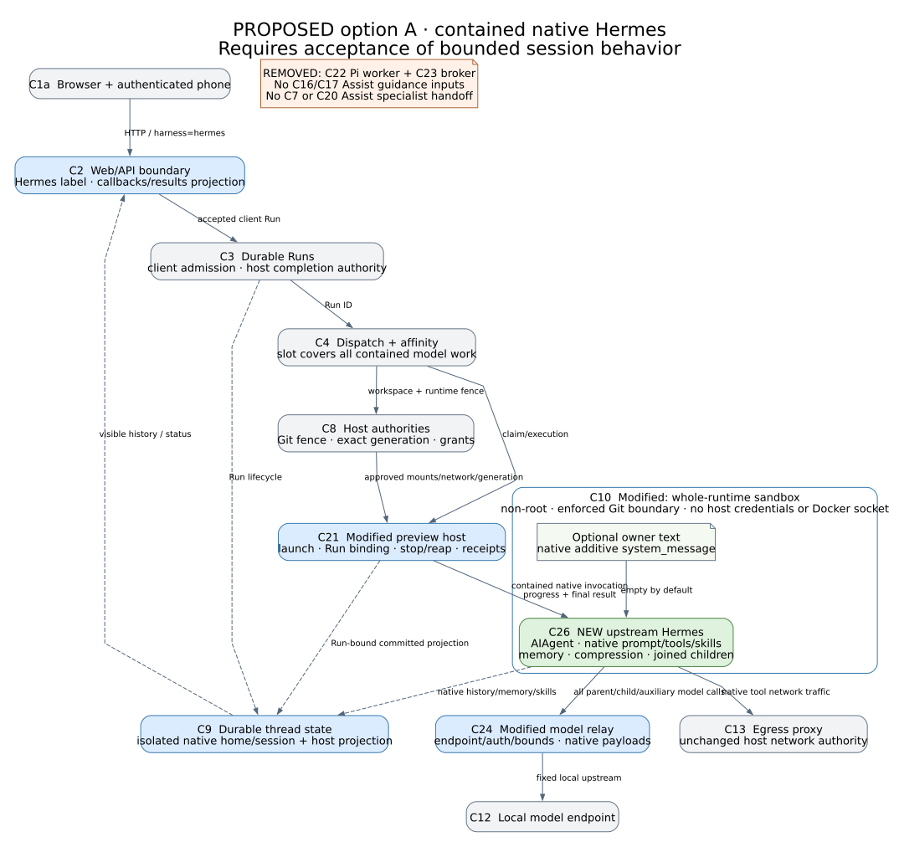
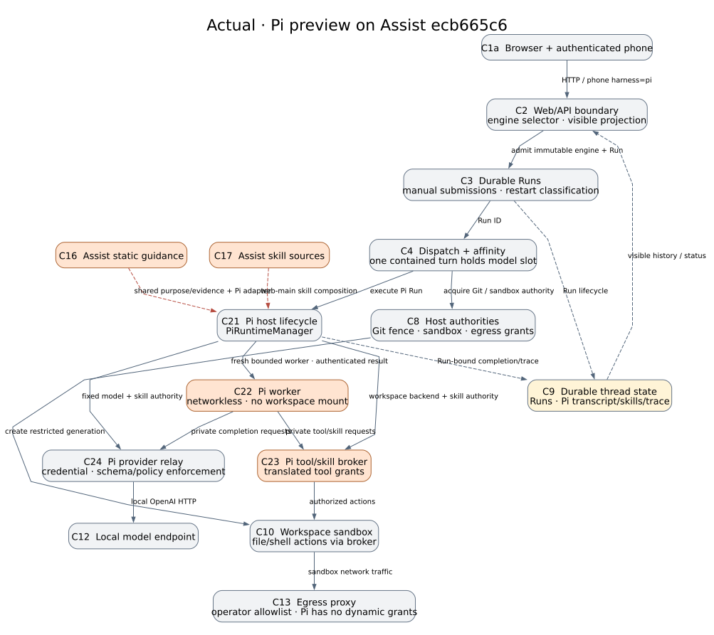

#+title: Decision on the Hermes Agent preview
#+date: 2026-11-10
#+options: toc:nil num:nil

Pierre selected option A on 2026-11-10. Assist will host native Hermes
Agent inside the existing bounded Run. Each submitted turn gets its own
runtime sandbox. The user's conversation, skills and memory can carry
across turns in the thread's isolated Hermes home. Work ends with the Run,
including tool processes and delegated children. Every new Hermes Run starts
with a user submission.

Hermes owns its prompts, tools, skills, memory, compression and delegation.
The owner may add one short block of high-level guidance through native
=system_message=, empty by default. The isolated Hermes home and selected
workspace define the sources Hermes can discover. Assist's prompts, skill
catalog and specialist delegation stay on the Deep Agents path.

The [[file:2026-11-10-hermes-agent-design.org][original design]] records the evidence, alternatives and migration.
Its reviewed commit is =92c0897bcb539a13ec4ddb6df82b1cd2c0924b02=, based on
Assist =ecb665c629429803a892f0245b600e266ef5a430=. The Hermes source examined
there is =ec3249919accf7bc51f780dcff663e8f19a0e176=. This decision selects
the design for future implementation.

* Architecture

The essential change is the replacement of the Pi worker and broker by one
contained Hermes runtime. Assist owns admission, model affinity and teardown.
Hermes owns conversation state and agent behavior.

The proposal diagram predates the decision. Its subtitle refers to the
bounded lifetime Pierre accepted. The  shows the source
boundary this replaces. Both use the [[file:architecture.org][merged component IDs]].

- C3 admits the client submission and owns the terminal Run outcome. C4
  holds the affinity slot through the complete bounded turn. C21 launches
  C26 and maps progress and final results to Assist.
- C10 contains C26, the pinned Hermes runtime, its native tool processes
  and joined delegation. C26 runs =AIAgent.run_conversation=. C22 and C23
  leave active execution. C24 carries
  bounded provider requests from the parent, children and auxiliary calls
  to the configured local model. Hermes keeps its native request semantics.
- C8 owns the generation, egress, Git fence and publication. Publication,
  deletion and affinity release follow verified teardown. Git-bound work
  requires the sandbox's enforced publication boundary. C9 holds separate
  native thread state and the Assist Run and history projection.
- C2 presents the new =hermes= identity to the browser and authenticated
  phone API. Existing =pi= threads have a read-only history, with an
  explicit summary handoff to an independent thread if requested.

A native request for detached execution must join within the Run or receive
an unavailable result. Session storage is available to the next user turn.
It cannot admit work. This gives a single lifetime owner for model calls and
workspace writers, including during cancellation, restart and Git publication.

* Acceptance cases for option A

The original plan's client, safety, approval and recovery checks apply to
this path. The first integrated case is a browser turn that changes a file
through a native Hermes tool, followed by a second turn that uses native
history to revise it. The browser shows one final result per Run. The phone
API exercises the same harness selection and history contract.

| Case | Evidence required from the implementation |
|------+-------------------------------------------|
| Native behavior | In a fresh thread, compare effective prompt, tool names and skill roots to pinned Hermes under the same explicit configuration. Exercise a native skill and joined delegation. Add optional owner guidance and verify the additive block, including after compaction. Check parent and child configuration for inadvertent Assist instructions or specialist tools. |
| Bounded work | Request parallel and detached work. Native children return within the Run or report unavailability. Stop during a tool, child or model request and prove that all descendants and model admission are gone before affinity release, publication or deletion. Disconnect after a turn and verify that no worker, schedule, or completion can start another Hermes Run. |
| Continuity and interruption | Restart between completed turns and exercise compaction. The original thread recalls its native state and a separate thread cannot. Crash after a file write and before final commit. Report the ambiguous outcome and retain the file without replay. Lose the client response after a committed reply and recover that reply once without another execution. |
| Host authority | Probe host paths, neighboring threads, credentials, privileged sockets, blocked egress, model routes and alternate Git binaries from the actual sandbox. Only C8 can publish. Exercise concurrent requests while C4 or the Git fence is held and verify that the web loop stays responsive. |
| Approvals and clients | Exercise enabled native approval or clarification through the real client transport, including stale cards and a restart while waiting. Withhold a gated capability where its transport is unavailable. Verify retry identity, cancellation and history from browser and phone, and confirm that retired Pi threads remain readable. |

These are implementation acceptance cases. The baseline checks in the
original design exercised the existing Pi contracts. Native browser and web
search toolsets, and the scope of interactive approval and clarification,
still depend on a supported host boundary and explicit enablement.

* Historical supersessions

In the [[file:2026-11-10-hermes-agent-design.org][2026-11-10 design]], the conditional recommendation in “Essential
change and the decision it needs” and the lifetime questions 1–2 in
“Decisions for Pierre's design review” are resolved by Pierre's selection of
A. The bounded part of case 3 in “Cases required before an implementation
could be accepted” is the acceptance path for delegation and background
behavior. The original design remains the record of the alternatives and
the evidence available before selection.
