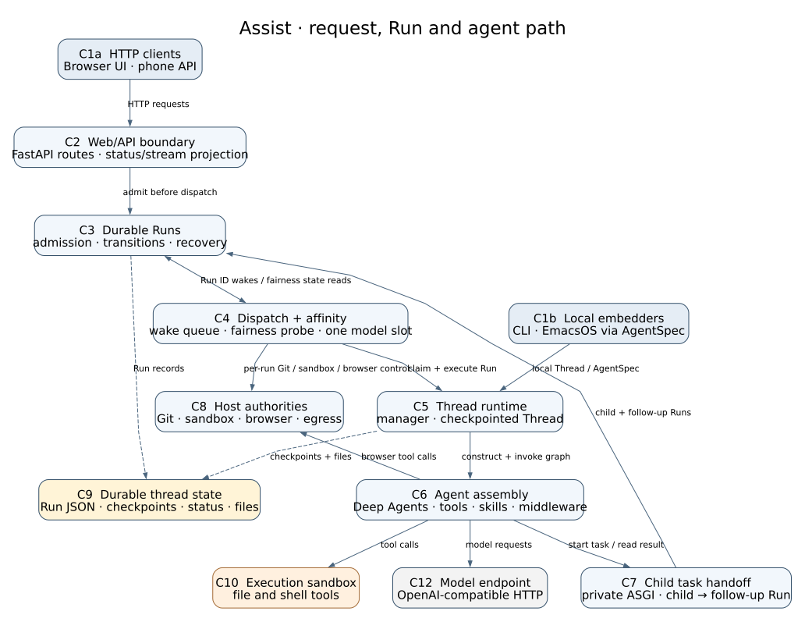
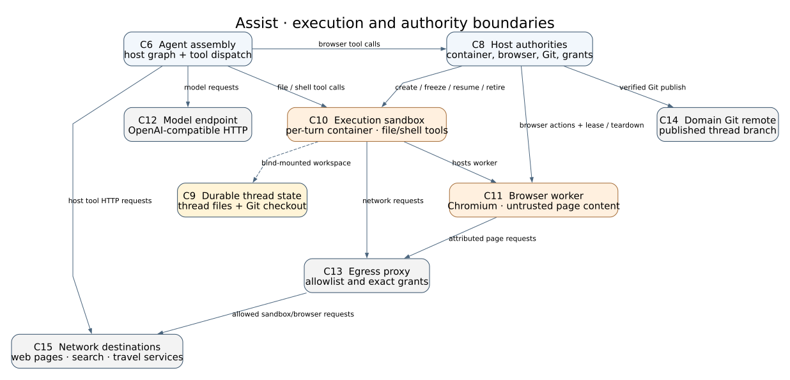
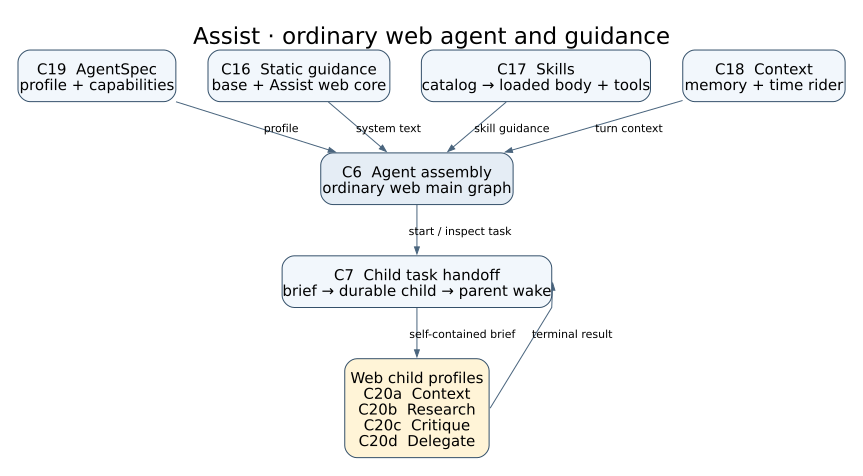

#+title: Assist architecture

This map follows the source in this branch. It shows the ordinary Deep Agents
web path and the interfaces other clients use. A Pi preview thread,
voice call, inbound SMS, scheduled prompt, or child task enters through a
different admission route, then uses the same durable Run service where that
route creates a Run. The diagrams show ownership and major data
flows, not a function call graph.

The component key also links the implemented browser delta in this checkout:
[[file:browser-site-compatibility.org][browser compatibility map and local review guide]].
It uses the same C8/C10/C11/C13 IDs and shows the changed control and network
connections. Other separately deployed feature branches are outside this view.

The source is [[file:architecture.dot][architecture.dot]]. Regenerate the SVG
locally with =dot -Tsvg docs/architecture.dot -o docs/architecture.svg=.
Solid arrows carry requests, control, work, or reads through a service API.
Dashed arrows connect components to stored data. Arrow labels say what crosses
each boundary. The numbered IDs are stable component names for discussing
later changes.

* Component key

The overview shows request admission and execution. The second view shows the
authority boundary around tools and external effects:

Edit [[file:architecture-boundaries.dot][architecture-boundaries.dot]] and render
it with =dot -Tsvg docs/architecture-boundaries.dot -o docs/architecture-boundaries.svg=.
The same IDs identify the same components
in both views. An ID shown in only one view keeps that meaning.

** Entry and orchestration

- *C1a HTTP clients.* The browser talks to [[file:../manage/web/threads.py][web
  routes]]. Authenticated phone requests enter through
  [[file:../manage/web/phone_api.py][phone_api.py]]. Their client
  implementations are outside this map. The Agent Protocol used by C7 is a
  private in-process adapter, not a public web route.
- *C1b Local embedders.* The CLI builds a local Thread in
  [[file:../manage/cli.py][manage/cli.py]]. EmacsOS embeds Assist through
  [[file:../assist/spec.py][AgentSpec]]. This direct route does not pass through
  the FastAPI boundary or the web Run admission service.
- *C2 Web/API boundary.* [[file:../manage/web/app.py][app.py]] owns FastAPI;
  [[file:../manage/web/threads.py][threads.py]] admits web messages and renders
  thread state. [[file:../manage/web/run_stream.py][run_stream.py]] journals
  stream events. [[file:../manage/web/state.py][state.py]] owns web process
  singletons and lifespan recovery.
- *C3 Durable Runs.* [[file:../assist/run_service.py][RunService]] persists Run
  identities and transitions. [[file:../manage/web/threads.py][=_create_run=,
  =_accept_message_run= and =queue_recovery_runs=]] admit work before dispatch
  and reconstruct pending work after restart. C4 reads current Run, approval,
  browser-reset and recovery-successor state here before counting a queued wake
  as a fairness waiter. The legacy backlog is migration input, not new-work
  authority.
- *C4 Dispatch + affinity.* [[file:../manage/web/threads.py][=_PriorityRunQueue=
  and =_ResumeScheduler=]] carry queued Run ID notifications in user-priority
  and background FIFO tiers; reservations are invisible until committed.
  [[file:../assist/thread_queue.py][ThreadAffinityQueue]] serializes model
  turns with thread affinity. Its fairness tick also counts eligible queued
  notifications for other threads, then requests a cooperative pause after the
  quantum. A separate timer enforces the cumulative active-time cap even if
  the eligibility read stalls. An ordinary first web turn runs in a FastAPI
  =BackgroundTask=; the resume scheduler handles resumptions and recoveries.
  The web worker [[file:../manage/web/threads.py][=_process_message=]] owns the
  Git, sandbox and browser control before it constructs C5. In-memory
  queues do not replace Run records.

** Agent and durable state

- *C5 Thread runtime.* [[file:../assist/thread_manager.py][ThreadManager]]
  owns thread directories, a shared SQLite checkpointer and model selection.
  [[file:../assist/thread.py][Thread]] builds and invokes the graph and resumes
  from checkpoints.
- *C6 Agent assembly.* [[file:../assist/agent.py][=create_agent=]] assembles
  Deep Agents with its backend, tools, skills, prompt and middleware.
  [[file:../assist/spec.py][AgentSpec]] adds embedder capabilities.
  [[file:../assist/backends.py][backends.py]] routes workspace, private state
  and skill paths.
- *C7 Child task handoff.* [[file:../assist/async_subagents.py][=start_async_task=
  and task tools]] call a private Agent Protocol ASGI app via in-process
  transport. [[file:../manage/web/__init__.py][Web composition]] keeps it off
  the public app; [[file:../manage/web/protocol_service.py][WebAgentProtocolService]]
  maps child calls to C3's durable Runs. [[file:../manage/web/threads.py][=_execute_child_run= and
  =_complete_child_handoff=]] execute its durable Run and create an ordinary
  parent follow-up Run after completion.
- *C9 Durable thread state.* [[file:../assist/run_service.py][RunService]]
  writes Run JSON under the thread root. [[file:../assist/thread_manager.py][ThreadManager]]
  stores LangGraph checkpoints in =threads.db= and owns thread directories.
  [[file:../manage/web/state.py][state.py]] writes UI status markers. The
  workspace can be a per-thread Git checkout or ordinary files.

** Authority and external effects

- *C8 Host authorities.* [[file:../assist/domain_manager.py][DomainManager]]
  and [[file:../assist/thread_git.py][ThreadGit]] manage thread Git state and
  publication through the web worker's
  [[file:../manage/web/thread_git_lifecycle.py][GitLifecycle]].
  [[file:../assist/sandbox_manager.py][SandboxManager]] owns turn
  containers; [[file:../assist/browser/manager.py][BrowserManager]] and
  [[file:../assist/browser/authority.py][browser authority]] own browser
  lifetime and leases. [[file:../assist/egress/store.py][EgressStore]] owns
  exact host/port grants.
- *C10 Execution sandbox.* [[file:../assist/sandbox.py][DockerSandboxBackend]]
  sends file and shell tools to one restricted container shared by a logical
  parent turn and its eligible children, with a bound workspace and scratch.
  It has no private =/agent= mount or generic application environment. Visible
  parent file tools reach private state through C6's host-side composite route;
  child file and shell tools receive neither that route nor browser tools.
  [[file:../assist/sandbox_manager.py][SandboxManager]] creates and cleans it.
  Non-Git web work can fall back to a host backend when Docker is unavailable;
  Git-bound turns fail closed. The CLI is host-backed.
- *C11 Browser worker.* C6's browser tools call the host-side
  [[file:../assist/browser/manager.py][BrowserManager]], which controls the
  session and invokes [[file:../assist/browser/runner.py][BrowserWorker]] inside
  the turn sandbox. In this branch the worker controls full native Chromium
  with software rendering and a sealed private CDP channel; see the
  [[file:browser-site-compatibility.org][browser compatibility view]].
  A fairness successor reuses its exact session/backend after C8 freezes the
  container with Docker pause. C8 unpauses only the same logical work, direct
  user event and generation after checking the current admission sequence.
  An unconfirmed unpause closes the session and attempts exact-generation
  teardown before releasing the slot; failed stop proof remains tracked.
  The original lease owner remains stable across physical Run slices, including
  accepted-approval execution and task-completion continuations. A retained
  completion slice skips the initial Git handoff rather than stopping its writer.
  Entering an approval wait, terminal and error boundaries close the browser;
  new-user and cancellation
  resets prove the frozen generation stopped before releasing held work.
  Checkpoint-verified approval repair may replace a cancelled physical slice;
  explicit cancellation receipts keep the entire logical work revoked.
  The existing three-hour container expiry includes frozen queue time.
  An eligible child borrows the same backend after its durable parent work and
  user event match the owner. Child execution refreezes it before releasing the
  model/checkout scopes. Parent background processes and page JavaScript run
  during that shared slice; unrelated work keeps them frozen. Child Git
  publication is deferred until the parent stops the writable generation.
  [[file:2026-11-12-browser-shared-execution.org][The shared-execution design]]
  records the accepted boundary and cancellation/error preservation behavior.
  [[file:../assist/browser/storage.py][storage.py]] holds a limited later-turn
  storage snapshot, not live tabs.
- *C12 Model endpoint.* [[file:../assist/model_manager.py][model_manager.py]]
  discovers and selects the OpenAI-compatible chat model. Inference is outside
  Assist and uses =ASSIST_MODEL_URL=.
- *C13 Egress proxy.* [[file:../assist/sandbox_manager.py][SandboxManager]]
  starts the proxy and isolated networks. [[file:../assist/egress/store.py][EgressStore]]
  projects approved grants; [[file:../assist/egress/client_map.py][client_map.py]]
  attributes browser traffic. It gates sandbox and browser network traffic,
  not host Python tool requests. The
  [[file:browser-site-compatibility.org][browser view]] describes this branch's
  bounded browser connection burst and the retained destination policy.
- *C14 Domain Git remote.* [[file:../assist/thread_git.py][ThreadGit]] and
  [[file:../assist/git_sync.py][git_sync.py]] prepare and verify publication of
  a thread branch. The remote is optional for non-Git threads.
- *C15 Network destinations.* [[file:../assist/tools.py][tools.py]] provides
  search and URL fetching; [[file:../assist/geo/tools.py][geo/tools.py]] and
  related travel tools call configured services. Websites visited by C11 are
  also destinations. Host Python tools call services directly; sandbox and
  browser requests cross C13's allowlist and exact-grant boundary first.

** Agent and guidance view

This view follows the ordinary Deep Agents web main. It uses the same C6/C7
IDs as the overview. The four named child types are product Assist agents,
not development roles.

Edit [[file:architecture-agents.dot][architecture-agents.dot]] and render it
with =dot -Tsvg docs/architecture-agents.dot -o docs/architecture-agents.svg=.
The arrow into C20a–d carries a self-contained brief. A terminal child result
returns through C7 as untrusted evidence; C7 creates a new parent Run, whose
agent retrieves the result with =get_async_task_result=.

*** Guidance entering the main agent

- *C19 AgentSpec.* [[file:../assist/spec.py][AgentSpec]] supplies
  embedder tools, skill routes, backend and delegation mode.
  [[file:../assist/thread_manager.py][ThreadManager.get]] chooses the ordinary
  web profile; [[file:../assist/agent.py][=create_agent=]] constructs C6 from it.
- *C16 Static guidance.* [[file:../assist/web_main_prompt.py][The web
  renderer]] assembles the Assist purpose, Deep Agents web adapter and evidence
  guidance from [[file:../assist/templates/deepagents/assist_core.md.j2][the
  core template]]. [[file:../assist/middleware/prompt_composition.py][Prompt
  composition]] puts the framework's base before that Assist core for this
  profile. The static text gives the agent its purpose, evidence rules, tool
  lifecycle and workspace boundaries.
- *C17 Skills.* [[file:../assist/middleware/skills_middleware.py][Skills
  middleware]] presents a dynamic catalog of skill names and descriptions.
  =load_skill= reveals a matching skill's body and declared tool contracts;
  normal compositions withhold those tools until that skill loads. The ordinary
  web main draws from [[file:../assist/main_guidance_skills/][grounding, research
  and thread-state guidance]], [[file:../assist/main_skills/][main-only
  orchestration]], [[file:../assist/skills/][shared skills]], and any present
  domain or web-supplied sources. The catalog is not the full set of skill bodies.
- *C18 Context.* [[file:../assist/middleware/memory_middleware.py][Memory
  middleware]] reloads repository =AGENTS.md= and, when private thread state
  exists, host-routed =/agent/memory.md= each turn. [[file:../assist/middleware/context_rider_middleware.py][The
  context rider]] adds current time context for the model call when supplied;
  it is not checkpointed as conversation history. Conversation messages and
  graph checkpoints belong to C5/C9.

*** Child work and other agent profiles

- *C7 Child task handoff.* [[file:../assist/async_subagents.py][Task tools]]
  launch a child with one self-contained description as its user message; the
  child does not receive the parent's conversation. The private Agent Protocol
  adapter and [[file:../manage/web/threads.py][completion handoff]] connect
  child Runs to a later parent Run.
- *C20a Context.* [[file:../assist/agent.py][=create_context_agent=]] uses
  [[file:../assist/templates/deepagents/context_agent.md.j2][context_agent.md.j2]]
  for read-only local discovery. It receives its own system guidance and
  filesystem tools, not C16's ordinary web core or C17's main skill catalog.
- *C20b Research.* [[file:../assist/agent.py][=create_research_agent(leaf=True)=]]
  uses [[file:../assist/templates/deepagents/sub_research.txt.j2][sub_research.txt.j2]]
  with search/read tools to gather external evidence. The web child is a leaf;
  the separate synchronous legacy research lead can dispatch inner specialists.
- *C20c Critique.* [[file:../assist/thread_manager.py][ThreadManager.get]] builds
  a read-only context-style graph with
  [[file:../assist/templates/deepagents/dev_critique.md.j2][dev_critique.md.j2]]
  to review the supplied code diff. It does not inherit the main's tool set.
- *C20d Delegate.* [[file:../assist/agent.py][=create_agent=]] uses
  [[file:../assist/templates/deepagents/general_instructions.md.j2][general_instructions.md.j2]]
  in delegate role, shared/domain skills and its caller research guidance.
  It owns one whole task with synchronous context, research and critique
  specialists. Main-only planning skills, web lifecycle tools and
  self-delegation are absent.

[[file:../assist/async_subagents.py][SUBAGENTS]] defines these four web task
names. Each graph has its own system prompt and available tool schemas; only
the delegate uses C17's general skill catalog and C18's repository memory.
Each receives C7's brief as its user message. The brief is not the parent's
system guidance or full conversation history.

- *Direct and restricted paths.* A local embedder can construct C6 with
  [[file:../assist/spec.py][AgentSpec]] without C7 or web Runs. With no explicit
  async task tools and no private thread memory, [[file:../assist/agent.py][=create_agent=]]
  registers synchronous context, research and critique specialists through
  =task=; that research profile can itself use search, critique and fact-check
  specialists. The web delegate also has synchronous specialists. Web triage
  instead receives an explicit empty async tool set and cannot delegate.
  These profiles have different tools and guidance; C16/C17 describe the
  ordinary web main specifically.

* Read one web request

A browser =POST /thread/{tid}/message= reaches C2. Its admission call runs
off the event loop, and C3 writes the Run before C4 receives its ID. C4 wakes
a worker; it acquires the affinity slot, then claims the Run before C5 invokes
C6. The agent can call
C10 tools, start a C7 child, or send a model request to C12. C5 checkpoints its
graph in C9; C3 persists the Run outcome. C2 projects status and stream events
for the browser. While one Run holds the model slot, C4's timer checks its
queued notifications against C3's current state. After the quantum, an eligible
other-thread wake requests a pause at the next model boundary; C3 records the
same-work successor before C4 runs it. Restart recovery scans C3 and requeues
unfinished IDs; queue membership itself is not durable.

C8 remains host-side authority for Git publication, sandbox lifetime, browser
leases and sandbox/browser network grants. Page content and workspace files in
C10/C11 are untrusted inputs to C6. They cannot grant their own network
access. A child
result returns through C7's private in-process adapter and a new parent Run,
so the parent can receive it even
after the original user turn has ended.

* Review the dispatch boundary

- Start with [[file:../assist/run_service.py][RunService]] and
  [[file:../manage/web/threads.py][=_recover_run=]] for durable Run and
  successor ownership. The in-memory queue carries notifications, not work
  authority.
- Follow [[file:../manage/web/threads.py][=_PriorityRunQueue.waiting_for_other=
  and =_ResumeScheduler._dispatch_waiter_count=]] into
  [[file:../assist/thread_queue.py][=ThreadAffinityQueue._on_tick= and
  =_on_cap=]]. The probe snapshots queued wakes before disk reads, excludes
  same-thread, browser-reset-held, approval-blocked and canceled wakes, plus
  interrupted predecessors whose newest resume/decision successor is no longer
  pending or running, or whose pending successor is held behind a browser-reset
  fence. The active-time cap remains independent of those reads.
- [[file:../tests/test_fair_scheduling_integration.py][The integrated fairness
  regression]], [[file:../tests/test_event_late_replay.py][late replay test]]
  and [[file:../tests/test_thread_queue.py][cap test]] cover the handoff. C8
  still owns Git, sandbox and browser effects; execution shares that one model
  slot. C6 routes parent-private state outside shared execution, and C7 borrows
  the active parent's restricted generation without child publication.
- For browser continuity, follow [[file:../assist/browser/manager.py][=pause=
  and =resume_session=]] and [[file:../manage/web/threads.py][=_process_message=
  and =_drain_held_browser_events=]]. The integrated fairness test exercises
  open, fill, a competing-thread quantum yield, resume and exactly one submit.
  Its opt-in Docker variant uses network-isolated Chromium with a synthetic
  HTTP form and proves a background writer stays frozen for another workspace
  but runs during same-parent child execution. It replaces worker startup; the
  [[file:../tests/test_browser_docker.py][production bootstrap/UID/proxy test]]
  separately checks private-state denial and armed-worker pause/resume.
  [[file:../tests/test_thread_git_simple.py][Real temporary Git tests]] prove
  publication waits for writer stop, errors preserve a recoverable commit and
  cancellation preserves local effects behind the clean preflight.
  [[file:../tests/test_browser_lifecycle_v12.py][The lifecycle tests]]
  prove newer-user/cancellation reset receipts survive failed stop attempts.

* Conditional paths and limits of this view

The web route can select a Pi preview engine instead of C6's Deep Agents
graph; its implementation is [[file:../assist/pi_runtime.py][PiRuntimeManager]].
The CLI and embedders can use host-backed or embedder-supplied backends, so
C10/C11 depict the ordinary sandboxed web path. Inbound SMS, schedules, voice
and approvals have their own interfaces and rules; this map does not detail
those workflows or external client internals. The component names describe
current responsibilities. The linked browser view describes this branch's
implemented compatibility delta; separately deployed features need their own
source-specific views.
