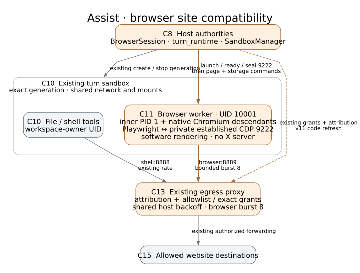

#+title: Browser site compatibility: architecture and review guide
#+options: ^:nil

* Essential change

Some public sites accepted an initial visit through the old Playwright
headless-shell path but blocked a delayed natural search or reload. Approved
scripts could also lose a parallel connection to the local host throttle.
The browser now controls full native Chromium through Playwright's public
CDP interface, with software rendering and a sealed private control channel.
The proxy admits a bounded browser connection burst within its existing
shared host backoff window. Host authorization and turn ownership stay with
their existing components.

This view describes the implemented browser delta in this checkout, using the
stable IDs in [[file:architecture.org][the main architecture map]]. Its merged
baseline is =ecb665c6= (architecture PR308, documenting runtime =df4bb845=).
The browser code is the reviewed =04ae3956= candidate from PR309. The current
maintenance rebase adds architecture documentation while preserving those
runtime bytes. A deployment can contain additional separately reviewed changes;
this map covers the source in this branch.

Edit [[file:browser-site-compatibility.dot][the DOT source]] and regenerate with
=dot -Tsvg docs/browser-site-compatibility.dot -o docs/browser-site-compatibility.svg=.
Orange marks changed behavior or connections; gray marks retained structure.
The C10 enclosure is the turn container; its inner C10 node represents ordinary
file/shell tools. C11 shares that container's network and mounts, with its own
UID and PID namespace.

* Where the change lives

| ID | Responsibility and code | Change in this branch |
|----+-------------------------+-----------------------|
| C8 | [[file:../assist/browser/manager.py][BrowserSession]] and [[file:../assist/browser/turn_runtime.py][turn_runtime.launch]]; [[file:../assist/sandbox_manager.py][SandboxManager]] | Verify the exact generation and worker identity, then seal new debugging connections before returning startup success. Refresh the proxy fingerprint for the changed connection admission. |
| C10 | [[file:../assist/sandbox_manager.py][SandboxManager]] and [[file:../dockerfiles/launch-turn-browser.py][turn launcher]] | Existing per-turn container, UID separation, private runtime and generation lifetime are retained. The sandbox already supplies full Chromium; its independent pinned shell remains for smoke checks. |
| C11 | [[file:../assist/browser/runner.py][BrowserWorker.start_engine, _start and revoke]] | Start native Chromium, attach over public CDP, keep page-context creation lazy, preserve the download export boundary, and terminate descendants on revocation. |
| C13 | [[file:../dockerfiles/egress-proxy.py][HostThrottle, admit_host and target_policy]] and [[file:../assist/egress/client_map.py][client attribution]] | Admit up to eight browser connections in the same shared hostname window. Ordinary shell admission stays at one; destination authorization remains before connect. |

No component is added. The meaningful changes concentrate in C11's engine
control, the C8-to-C11 startup handshake and C13's connection admission.
C10 remains the containing generation, controlled by C8.

* Walk the essential path

1. A typed browser operation reaches C8's
   [[file:../assist/browser/manager.py][BrowserSession._start]]. It obtains the
   current turn container and binds the browser lease to that Run and exact
   generation. [[file:../assist/browser/turn_runtime.py][launch]] checks proxy
   attachments and the lease, installs the UID fence, publishes browser
   attribution, and invokes the existing turn launcher as UID 10001 with no
   capabilities. The ordinary shell uses the workspace owner's UID, distinct from the
   reserved browser UID 10001.
2. C11's [[file:../assist/browser/runner.py][start_engine]] starts
   =/usr/bin/chromium= with Ozone's headless platform and SwiftShader software
   rendering. It does not use Chromium's =--headless= or =--enable-automation=
   switches. It reads the debugging endpoint emitted by its own live child
   and attaches with =connect_over_cdp=. Only PATH, HOME and TMPDIR reach the
   native child; the private worker session token is excluded. There is no
   external display server.
3. C8 verifies the private worker's ready response: PID 1 in its namespace,
   UID/GID 10001, empty capabilities, no-new-privileges and seccomp enabled.
   After another lease check,
   [[file:../dockerfiles/install-browser-fence.py][seal_control]] rejects every
   new connection to IPv4 loopback port 9222. The already-established trusted CDP
   connection remains usable. This completes before C8 returns startup
   success and loads private storage or sends page commands. Before sealing,
   the UID fence already excludes ordinary shell processes from that port.
4. The first page open creates the lazy Playwright context. C11 sends page
   traffic through C13's attributed port 8889. The kernel permits browser UID
   traffic only to that proxy and the private control connection; it blocks
   browser IPv6 and prevents ordinary shell use of the browser listener.
   [[file:../dockerfiles/egress-proxy.py][target_policy]] still checks source
   attribution and the operator allowlist or exact thread/host/port grant.
   Browser admission reserves at most eight connections in a shared hostname
   backoff window, across pages and turns; ordinary port 8888 traffic retains
   its one-connection admission for remote hosts. The local model bridge keeps
   its existing throttle exemption. This lets approved parallel scripts load
   without granting new destinations or adding page retries.
5. C11 runs typed actions and returns bounded observations through the
   existing private Unix socket. Revocation closes the context, browser and
   driver, then the worker sends its reply and exits inner PID 1. That namespace
   exit kills native descendants while leaving the ordinary shell turn alive.
   Stopping the containing C10 generation also destroys Chromium; the existing
   common three-hour container expiry bounds a host-outage survivor.

* Supporting changes to read next

- [[file:../assist/browser/runner.py][download_info]] checks the completed
  Playwright artifact under the private runtime and copies it into the
  established download directory. The host's existing 20 MiB export guard
  remains in [[file:../assist/browser/manager.py][BrowserSession]].
- [[file:../assist/sandbox_manager.py][_egress_proxy_config_hash]] includes
  =v11-browser-connection-burst= so an old running proxy is refreshed for the
  new admission code. This is a deployment compatibility change within C8/C13.
- [[file:../dockerfiles/Dockerfile.browser][The legacy standalone image]] sets
  HOME and TMPDIR to its private =/run= mount. Its real entrypoint bypasses the
  turn launcher, so it needs its own defaults. The
  [[file:../dockerfiles/test-browser-runtime.sh][independent pinned-shell smoke]]
  explicitly keeps its existing private home/temp mounts. These paths do not
  change the turn launcher's private environment.
- [[file:../assist/browser/storage.py][Private later-turn storage]], generation
  leases, destination grants, non-HTTP navigation rejection and observed-target
  identity remain existing contracts. The engine change does not preserve live
  tabs or old DOM/page IDs across turns.

* Review the code and this view together

Start with =start_engine= and the C8 startup handshake, then inspect the UID
fence and C13 admission. Check that no page command or storage load precedes
sealing, a changed generation cannot reuse the session, and browser traffic
cannot replace the host's grant decision. Read revocation through the inner
PID 1 exit and the containing sandbox stop, rather than treating =browser.close=
alone as a lifetime proof.

Relevant existing checks are
[[file:../tests/test_browser_turn_runtime.py][startup and seal ordering]],
[[file:../tests/test_browser_uid_fence.py][UID/control fence rules]],
[[file:../tests/test_browser_runner.py][typed worker and download contracts]],
[[file:../tests/test_egress_approval.py][bounded shared host admission]],
[[file:../tests/test_browser_v1_docker.py][real UID, control, download and lifetime checks]],
and [[file:../tests/test_browser_docker.py][cross-generation storage and the actual standalone entrypoint]].
The earlier real acceptance path opens Amoeba, waits at least twelve seconds,
uses the observed natural search form, then reloads its result. That is typed
browser integration evidence, not a model-behavior eval or a claim that every
resource loads. Some incidental same-host images can still fail; login and
profile sharing remain outside this change.

The architecture-only maintenance preserves every tracked file outside
=README.md= and =docs/= from reviewed =04ae3956=. Check that directly with:

#+begin_src sh
git diff --exit-code 04ae3956 -- . ':!README.md' ':!docs/**'
#+end_src

Reuse the prior runtime checks for identical bytes. Validate the new map's
component ownership, labeled connections, code links and rendered SVG. No
runtime deployment, broad test rerun or new behavioral trial is implied by
this documentation maintenance.
