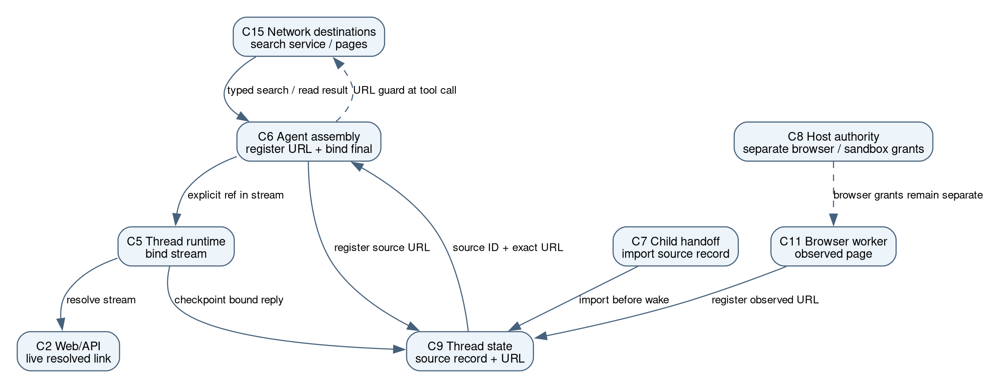

#+title: Source citation binding: code review notes
#+options: toc:2

* Current scope of this packet

These are local working notes for the citation change. The merged
[[file:architecture.org][baseline architecture]] names the components below.
The citation delta diagram shows only changed connections; it is not a new
map of the whole application.

The user-visible problem is precise: a search result supplied one URL, but an
assistant reply changed that URL's path. The essential change is to let the
host register a successful search row's URL, a successful =read_url= call's
requested URL, or an observed browser page URL under an opaque source ID.
When the agent copies =[Source](ref:r...)=, Assist resolves it to the host
record before delivery. Start in
[[file:../assist/thread_datastore.py][register_source]] and
[[file:../assist/thread_datastore.py][ReferenceBindingMiddleware]].

The contract covers explicit source references in streamed replies, canonical
history and saved research reports. Ordinary URLs and code examples remain
untouched. An invalid or foreign source ID produces a recoverable
unresolved-reference message. It does not report link reachability. Binding
establishes URL identity, not page availability, the destination after a
redirect, or whether the page supports a claim.

* Exact diff inventory

The original inventory was measured from =45d93049= to =4a197882=: 38
files, +2,408/−200 lines. The architecture rebase places the feature on
=ecb665c6=; its current reviewed patch spans 39 files, +2,550/−194 at
=65ef0242= before the local packet and current census correction. The
categories below describe the original feature inventory; raw churn shows
reading volume, not risk or semantic importance.

- Production Python: 14 files, +1,038/−159. The largest additions are the
  new [[file:../assist/thread_datastore.py][thread datastore and resolver]]
  (+461) and [[file:../assist/research_sandbox_files.py][sandbox file helper]]
  (+152). Existing [[file:../assist/research_cleanup.py][research cleanup]]
  (+129/−54), [[file:../assist/middleware/url_provenance.py][URL provenance]]
  (+66/−52), and [[file:../assist/thread.py][Thread]] (+79/−6) account for
  much of the changed code. Smaller child-handoff and tool-order changes
  carry essential behavior despite fewer lines.
- Agent guidance: 7 files, +36/−19. These are research skills, browser
  skill and prompt templates. The accompanying
  [[file:../edd/prompt_census.py][prompt census]] is a validation tool, not
  model guidance itself.
- Tests and eval support: 15 files, +1,319/−22. This includes the prompt
  census and focused checks for link identity, stream and stored parity,
  child import, sandbox transfer, browser capture and provenance.
- Current project guidance: =AGENTS.md= and =README.md=, +15/−0.

Two new production files do different jobs. =thread_datastore.py= contains both
thread-owned generic text records and the source resolver. The new
=research_sandbox_files.py= is a helper for existing research cleanup; its
file creation alone does not establish a separate architectural component.
The merged baseline groups the source record with C9 thread state and leaves
the sandbox file helper within the C10/completion implementation.

* Guided reading of the essential change

1. *Keep the exact URL outside model prose.* Read
   [[file:../assist/thread_manager.py][the host store path]],
   [[file:../assist/thread_datastore.py][ThreadDataStore]],
   [[file:../assist/thread_datastore.py][register_source]]
   and [[file:../assist/thread_datastore.py][source_url]]. The
   store is beside thread metadata, outside the agent workspace. Source
   records are host-authored; the generic text operation cannot mint one.
   Without this record, the model remains responsible for reproducing URL
   bytes. Check [[file:../tests/test_thread_datastore.py][persistence and thread scope]]
   and [[file:../tests/test_thread_datastore.py][spoofed result fields]].
2. *Register only successful typed retrieval URLs.* Read
   [[file:../assist/thread_datastore.py][the tool-result binder]]
   and [[file:../assist/browser/manager.py][observed browser URL capture]].
   Search rows get host-built =source_id= and =source_link= fields. Successful
   =read_url= output gets a =Source link:= prefix based on the requested URL;
   it does not claim the final URL after redirects. Browser capture uses the
   actual current page URL and returns =source_id=, not a proposed navigation
   target. Failed fetches and spoofed =source_id=/=source_link= fields in
   search rows cannot register trusted sources. Check
   [[file:../tests/test_thread_datastore.py][failed fetch]] and
   [[file:../tests/test_browser_wiring.py][failed navigation]].
3. *Bind explicit references in both output paths.* Read
   [[file:../assist/thread_datastore.py][resolve_references]],
   [[file:../assist/thread_datastore.py][ReferenceStream]]
   and [[file:../assist/thread.py][Thread._observe]]. The binder
   resolves final model messages before checkpointing; the stream adapter
   holds incomplete links across chunks and emits resolved Markdown. Without
   both paths, live output and stored history could disagree. Check
   [[file:../tests/test_thread_datastore.py][ordinary URL parity]],
   [[file:../tests/test_thread_datastore.py][checkpoint]] and
   [[file:../tests/test_web_process_message_e2e.py][web/phone stream]].
4. *Carry authority across child completion.* Read
   [[file:../manage/web/threads.py][parent import]]
   and [[file:../assist/async_subagents.py][task result formatting]].
   The host imports the child source records before the parent completion
   wake; the task result carries source rows and copyable links. Child prose
   does not register source URLs. Without durable import, the parent could
   receive a valid-looking source handle that disappears with the child.
   Check [[file:../tests/test_async_subagent_runs.py][durable wake]] and
   [[file:../tests/test_async_subagent_task.py][task result tests]].
5. *Resolve only the saved final report.* Read
   [[file:../assist/research_cleanup.py][research cleanup]],
   [[file:../assist/research_sandbox_files.py][sandbox-owned file operations]]
   and [[file:../manage/web/threads.py][completion binding]].
   The selected report is resolved before it is exposed as a saved file.
   Bounded transfer, a verified directory handle and no-follow checks keep
   that operation from rewriting an unrelated path. Check
   [[file:../tests/test_research_cleanup_sandbox.py][transfer]] and
   [[file:../tests/test_web_process_message_e2e.py][completion]].
6. *Keep source identity separate from navigation authority.* Read
   [[file:../assist/middleware/url_provenance.py][URL provenance]],
   [[file:../assist/agent.py][tool availability]] and
   [[file:../assist/main_guidance_skills/research/SKILL.md][main research guidance]].
   A stored source or datastore lookup does not by itself authorize a
   =read_url= call. The available datastore tools and skill instructions
   agree, and the agent is told to copy a supplied link rather than
   reconstruct a URL. Check [[file:../tests/test_url_provenance.py][guard tests]]
   and [[file:../tests/test_create_agent_spec.py][construction tests]].

* Included scope and evidence limits

Generic get/list/search for text records is independently useful included
scope requested with the citation change; it is not a writable source
registry. Browser capture extends the same explicit-reference contract to
that existing retrieval surface. The sandbox report helper strengthens file
ownership during report finalization. None of these changes turns a source ID
into permission to visit the URL.

The linked deterministic checks cover source identity and principal delivery
boundaries. The natural small-model
[[file:../edd/eval/test_source_reference_binding.py][source-binding eval]]
uses a synthetic search result and a natural Shudder question with a follow-up
variant. Its result measures link behavior in that fixture, not page
availability or factual support. Earlier measured main and leaf counts remain
in PR302's detailed validation prose; this documentation-only pilot does not
rerun models or rewrite those accounts.

* Delta from the merged architecture baseline

The editable graph is [[file:source-citation-binding-delta.dot][source-citation-binding-delta.dot]];
 retains scalable labels. The
C6 tool-result binder registers a successful C15 retrieval URL in a
thread-owned C9 source record. C6 gives the model an opaque link and binds
an explicit reference in its final message. C5 checkpoints that bound message
in C9 and binds streamed chunks before C2 delivers live output. C7 imports
a child record into the parent thread before
the completion wake, so a copied child reference still resolves. The C11
browser path registers its observed page URL through the same host record.
The C6 URL guard still decides whether a child may call =read_url=;
C8's browser grants remain separate. A source ID alone grants neither.

These are connections among existing baseline components, plus a source
record inside C9. The sandbox report file helper remains an implementation
detail of C10 and the completion path, not a new architectural node.
