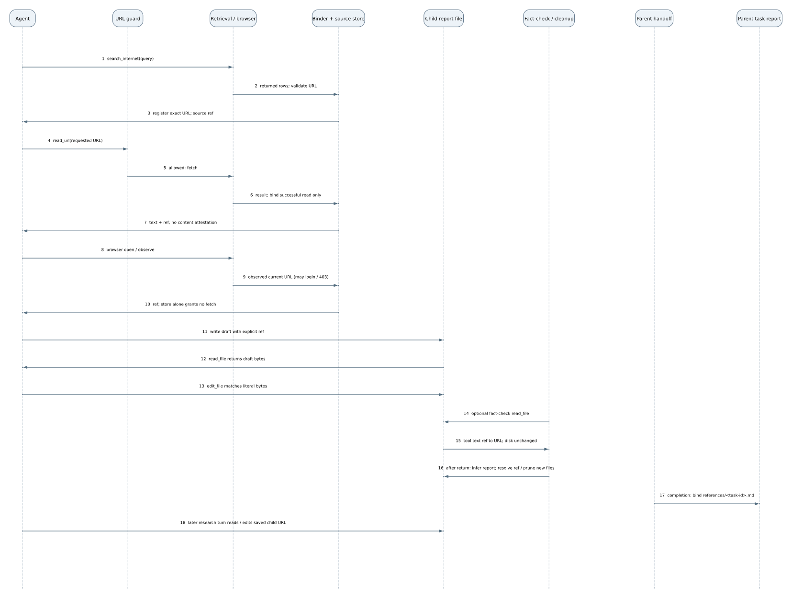

#+title: Source citation binding: code review notes
#+options: toc:2

* Current scope of this packet

These are local working notes for the citation change. The merged
[[file:architecture.org][baseline architecture]] names the components below.
The citation delta diagram shows only changed connections; it is not a new
map of the whole application.

The user-visible problem is precise: a search result supplied one URL, but an
assistant reply changed that URL's path. The essential change is to let the
host register a URL from a returned =search_internet= row, a successful
=read_url= tool result tied to its requested URL, or an observed browser page
URL under an opaque source ID. A tool error or a browser request alone does
not register a source. Registration does not prove that a page was fetched or
that its content supports a claim.
When the agent copies =[Source](ref:r...)=, Assist resolves it to the host
record before delivery. Start in
[[file:../assist/thread_datastore.py::106][register_source (line 106)]] and
[[file:../assist/thread_datastore.py::402][ReferenceBindingMiddleware._bind_result (line 402)]].

The contract covers explicit source references in streamed replies, canonical
history and saved research reports. Ordinary URLs and code examples remain
untouched. An invalid or foreign source ID produces a recoverable
unresolved-reference message. It does not report link reachability. Binding
establishes URL identity, not page availability, the destination after a
redirect, or whether the page supports a claim.

* Exact diff inventory

The original inventory was measured from =45d93049= to =4a197882=: 38
files, +2,408/−200 lines. The architecture rebase places the feature on
=ecb665c6=; its current reviewed patch spans 39 files, +2,550/−194 at
=65ef0242= before the local packet and current census correction. The
categories below describe the original feature inventory; raw churn shows
reading volume, not risk or semantic importance.

- Production Python: 14 files, +1,038/−159. The largest additions are the
  new [[file:../assist/thread_datastore.py::42][ThreadDataStore (line 42)]]
  (+461) and [[file:../assist/research_sandbox_files.py::8][SANDBOX_FILES (line 8)]]
  (+152). Existing [[file:../assist/research_cleanup.py::65][ReferencesCleanupRunnable (line 65)]]
  (+129/−54), [[file:../assist/middleware/url_provenance.py::451][UrlProvenanceMiddleware (line 451)]]
  (+66/−52), and [[file:../assist/thread.py::148][Thread (line 148)]] (+79/−6) account for
  much of the changed code. Smaller child-handoff and tool-order changes
  carry essential behavior despite fewer lines.
- Agent guidance: 7 files, +36/−19. These are research skills, browser
  skill and prompt templates. The accompanying
  [[file:../edd/prompt_census.py::257][CensusTrace (line 257)]] is a validation tool, not
  model guidance itself.
- Tests and eval support: 15 files, +1,319/−22. This includes the prompt
  census and focused checks for link identity, stream and stored parity,
  child import, sandbox transfer, browser capture and provenance.
- Current project guidance: =AGENTS.md= and =README.md=, +15/−0.

Two new production files do different jobs. =thread_datastore.py= contains both
thread-owned generic text records and the source resolver. The new
=research_sandbox_files.py= is a helper for existing research cleanup; its
file creation alone does not establish a separate architectural component.
The merged baseline groups the source record with C9 thread state and leaves
the sandbox file helper within the C10/completion implementation.

* Guided reading of the essential change

1. *Keep the exact URL outside model prose.* Read
   [[file:../assist/thread_manager.py::540][ThreadManager.thread_datastore_path (line 540)]],
   [[file:../assist/thread_datastore.py::42][ThreadDataStore (line 42)]],
   [[file:../assist/thread_datastore.py::106][register_source (line 106)]]
   and [[file:../assist/thread_datastore.py::121][source_url (line 121)]]. The
   store is beside thread metadata, outside the agent workspace. Source
   records are host-authored; the generic text operation cannot mint one.
   Without this record, the model remains responsible for reproducing URL
   bytes. Check [[file:../tests/test_thread_datastore.py::358][test_datastore_text_get_list_search_survive_recreation_and_are_thread_scoped (line 358)]]
   and [[file:../tests/test_thread_datastore.py::196][test_source_link_is_host_authored_even_if_result_contains_spoofed_fields (line 196)]].
2. *Register URLs from retrieval tool results.* Read
   [[file:../assist/thread_datastore.py::402][ReferenceBindingMiddleware._bind_result (line 402)]]
   and [[file:../assist/browser/manager.py::758][browser_tools.invoke (line 758)]].
   Returned search rows with valid source URLs get host-built =source_id= and
   =source_link= fields; the binder does not fetch those URLs or add a
   =read_url= call. A successful
   =read_url= tool result gets a =Source link:= prefix based on the requested
   URL; this does not establish the final URL after redirects. For browser
   =open=, =observe=, =act= and =wait=, the host registers the actual current
   page URL returned in an observation without a =navigation_failed= marker.
   A login, challenge or HTTP 403 page can therefore have a registered current
   URL without proving access to its intended content. Merely requesting a
   browser URL does not register it, and a navigation failure registers none.
   Spoofed =source_id=/=source_link= fields in search rows are stripped;
   host-built fields replace them only when URL registration succeeds. Check
   [[file:../tests/test_thread_datastore.py::169][test_failed_long_read_url_offload_does_not_register_source (line 169)]] and
   [[file:../tests/test_browser_wiring.py::25][test_failed_browser_navigation_does_not_register_attempted_url (line 25)]].
3. *Bind explicit references in both output paths.* Read
   [[file:../assist/thread_datastore.py::197][resolve_references (line 197)]],
   [[file:../assist/thread_datastore.py::242][ReferenceStream (line 242)]]
   and [[file:../assist/thread.py::337][Thread._observe (line 337)]]. The binder
   resolves final model messages before checkpointing; the stream adapter
   holds incomplete links across chunks and emits resolved Markdown. Without
   both paths, live output and stored history could disagree. Check
   [[file:../tests/test_thread_datastore.py::414][test_explicit_reference_binding_preserves_ordinary_links_in_stream_and_history (line 414)]],
   [[file:../tests/test_thread_datastore.py::430][test_framework_checkpoint_stores_resolved_message (line 430)]] and
   [[file:../tests/test_web_process_message_e2e.py::370][test_search_reference_reaches_phone_stream_and_durable_run (line 370)]].
4. *Carry authority across child completion.* Read
   [[file:../manage/web/threads.py::2897][_complete_child_handoff (line 2897)]]
   and [[file:../assist/async_subagents.py::113][_format_task (line 113)]] and
   [[file:../assist/async_subagents.py::213][_get_async_task_result (line 213)]].
   The host imports the child source records before the parent completion
   wake; the task result carries source rows and copyable links. Child prose
   does not register source URLs. Without durable import, the parent could
   receive a valid-looking source handle that disappears with the child.
   Check [[file:../tests/test_async_subagent_runs.py::378][test_research_task_acceptance_and_completion_create_durable_parent_wake (line 378)]] and
   [[file:../tests/test_async_subagent_task.py::22][test_task_source_link_is_built_from_host_source_id (line 22)]].
5. *Resolve only the saved final report.* Read
   [[file:../assist/research_cleanup.py::106][ReferencesCleanupRunnable._post_invoke_cleanup (line 106)]],
   [[file:../assist/research_sandbox_files.py::8][SANDBOX_FILES (line 8)]]
   and [[file:../manage/web/threads.py::2571][_bind_task_report (line 2571)]].
   The child can write =[Source](ref:r...)= in its report draft. At research
   finalization, [[file:../assist/research_cleanup.py::122][ReferencesCleanupRunnable._resolve_report_references (line 122)]]
   converts those explicit references to stored URLs in only the selected
   final report. The wrapper runs after the research invoke returns. It first
   selects the most recent existing report targeted by =write_file= or
   =edit_file=; a =FINAL_REPORT= filename marker is the fallback. It resolves
   only a new or changed selected report and prunes other newly created files
   in =references/=; pre-existing files remain. If no existing final filename
   can be inferred, it leaves files alone; an exception before cleanup also
   skips it. This selection follows tool and marker evidence,
   not a semantic draft classification. Separately, after the parent
   task-completion chat returns, =_bind_task_report= resolves the named
   =references/<task-id>.md= report. These are one-way conversions on saved
   files. A checker
   =read_file= can optionally convert references in its returned tool text via
   [[file:../assist/thread_datastore.py::402][ReferenceBindingMiddleware._bind_result (line 402)]],
   without rewriting the file. Reads never convert URLs back to references.
   Literal URLs written by the agent stay unchanged; once a source reference
   is resolved in a saved report, the resulting URL text does not identify
   whether it came from a reference or was written directly. Bounded transfer,
   a verified directory handle and no-follow checks keep finalization from
   rewriting an unrelated path. Check
   [[file:../tests/test_research_cleanup_sandbox.py::49][test_sandbox_report_binding_prune_and_transfer (line 49)]] and
   [[file:../tests/test_web_process_message_e2e.py::456][test_completion_binds_named_report_through_sandbox_transfer (line 456)]].
6. *Keep source identity separate from navigation authority.* Read
   [[file:../assist/middleware/url_provenance.py::323][_seen_urls (line 323)]],
   [[file:../assist/agent.py::340][create_agent (line 340)]] and
   [[file:../assist/main_guidance_skills/research/SKILL.md::7][Research workflow (line 7)]].
   A stored source or datastore lookup does not by itself authorize a
   =read_url= call. The available datastore tools and skill instructions
   agree, and the agent is told to copy a supplied link rather than
   reconstruct a URL. Check [[file:../tests/test_url_provenance.py::56][TestUrlProvenanceMiddleware (line 56)]]
   and [[file:../tests/test_create_agent_spec.py::64][TestSpecWiring (line 64)]].

* Included scope and evidence limits

Generic get/list/search for text records is independently useful included
scope requested with the citation change; it is not a writable source
registry. Browser capture extends the same explicit-reference contract to
that existing retrieval surface. The sandbox report helper strengthens file
ownership during report finalization. None of these changes turns a source ID
into permission to visit the URL.

The linked deterministic checks cover source identity and principal delivery
boundaries. The natural small-model
[[file:../edd/eval/test_source_reference_binding.py::21][test_natural_horror_research_uses_exact_source_reference (line 21)]]
uses a synthetic search result and a natural Shudder question with a follow-up
variant. Its result measures link behavior in that fixture, not page
availability or factual support. Earlier measured main and leaf counts remain
in PR302's detailed validation prose; the new file-update capability eval is
recorded separately and does not revise those historical results.

* File update and source identity

The local 
and its [[file:source-citation-binding-sequence.dot][editable DOT source]] show
tool-result registration, pre-fetch URL guarding, report writing and reads,
optional checker binding, and finalization. A source record preserves the
URL's identity; it does not attest that a page was accessible or supported a
claim, and a store lookup alone does not grant permission to fetch it.

Replacing every stored URL in every file read with a reference would change
ordinary text, instructions and code that happen to contain that URL. A later
=edit_file= matches =old_string= against literal disk bytes, so a reference
shown in the read result would not match an unchanged URL on disk. Resolving
that mismatch would require changing writes too. After finalization has
replaced a reference with its URL, the saved text no longer identifies which
URLs came from references. Exact store membership cannot recover that origin.
The focused [[file:../edd/eval/test_source_reference_binding.py::65][file-update capability eval (line 65)]]
measures the existing one-way behavior; this packet does not propose blanket
read rewriting. A URL denied by the guard returns feedback to the agent
without a retrieval call. The optional fact-check read happens before named
report finalization.

In the 2026-11-11 bounded capability run, the agent wrote and reread a
reference-bearing draft, edited Host into first position, and made a later
friend update after the first finalization had resolved the exact URL. The
last model run passed in 79.16 seconds. Its trace retains a recovered
=write_file= collision; the eval requires successful write/read/edit and later
read/update calls, not that every attempted call succeeds. This shows the
file-update path can work, not a natural-use pass rate.

* Delta from the merged architecture baseline

[[file:source-citation-binding-delta.png]]

The editable graph is [[file:source-citation-binding-delta.dot][source-citation-binding-delta.dot]];
[[file:source-citation-binding-delta.svg][SVG]] retains scalable labels. The
C6 tool-result binder registers a successful C15 retrieval URL in a
thread-owned C9 source record. C6 gives the model an opaque link and binds
an explicit reference in its final message. C5 checkpoints that bound message
in C9 and binds streamed chunks before C2 delivers live output. C7 imports
a child record into the parent thread before
the completion wake, so a copied child reference still resolves. The C11
browser path registers its observed page URL through the same host record.
The C6 URL guard still decides whether a child may call =read_url=;
C8's browser grants remain separate. A source ID alone grants neither.

These are connections among existing baseline components, plus a source
record inside C9. The sandbox report file helper remains an implementation
detail of C10 and the completion path, not a new architectural node.
